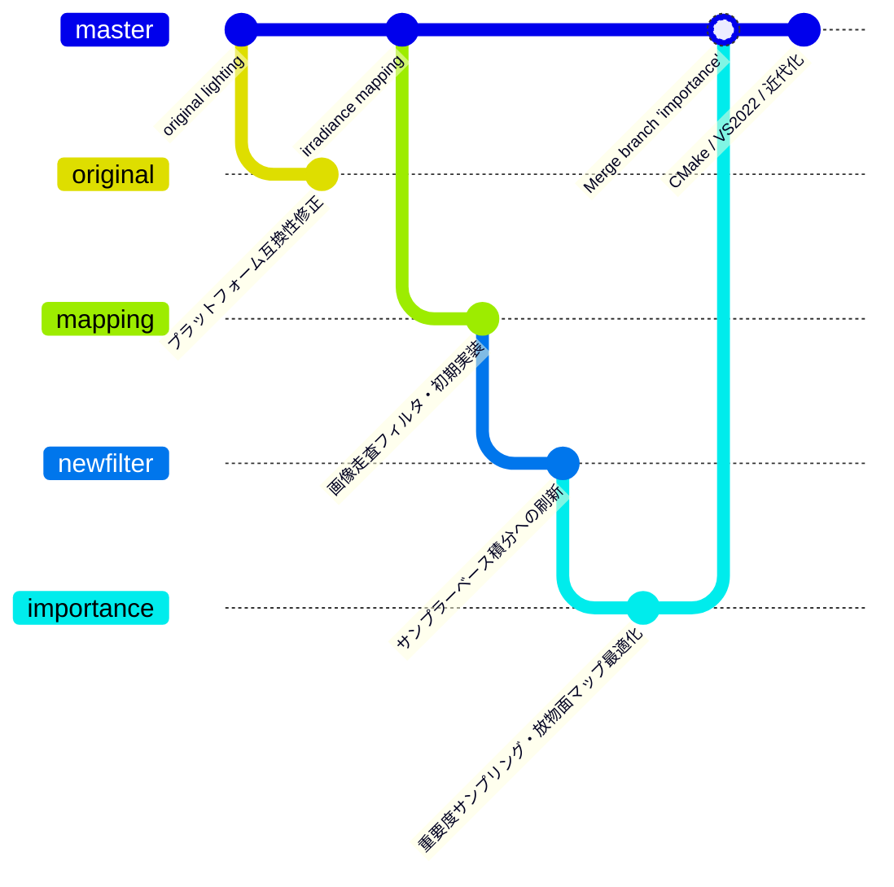

# irradiancemapping - 放射照度マッピングによる大域照明

## 1. 概要

本プログラムは、放射照度環境マップ（Irradiance Environment Map）を用いて、ディフューズ反射光の畳み込み計算結果を事前生成したテクスチャから高速に取得し、リアルタイムに環境光照度を反映するサンプルプログラムです。

- **シェーダ不使用**: プログラマブルシェーダを使わず、OpenGL のレガシー API（固定機能パイプラインのマルチテクスチャ / `GL_COMBINE`）のみで実装されています。
- **GLFW 3**: ウィンドウ管理および入力処理に GLFW 3 を使用しています。
- **モデルデータ**: 形状データには Alias OBJ 形式（`bunny.obj` 等）を使用します（実行時にテッセレーションは行わないため、あらかじめ三角形分割されたモデルを使用してください）。

### 参照ブログ記事

- [放射照度マッピング (1) - 床井研究室](https://tokoik.github.io/blog/2015-08-26.html)
- [放射照度マッピング (2) - 床井研究室](https://tokoik.github.io/blog/2015-08-28.html)

---

## 2. ブランチの構成と関係（履歴）

本リポジトリには、放射照度マッピング手法の段階的な実装とアルゴリズム改良、および現代のビルド環境への対応履歴を記録した 5 つのブランチが存在します。



### 各ブランチの役割

- **`original`**:
  放射照度マッピング導入前の初期状態です。従来の点光源（`lightPos`, `lightCol`, `lightAmb`）による標準的な OpenGL 固定機能ライティングを行っています。
- **`mapping`**:
  ブログ記事「放射照度マッピング (1)」に対応する初期実装ブランチです。天空画像から放射照度マップと環境マップを事前生成し、マルチテクスチャを用いて環境光を反映します。この段階では画像空間グリッドを二重ループ走査して畳み込み積分を行っていました。
- **`newfilter`**:
  ブログ記事「放射照度マッピング (2)」の前半に対応します。画像空間走査フィルタに代わり、半球上のサンプラーベクトルを法線方向に回転させるモンテカルロ的（乱数サンプリング）積分手法に刷新しました。
- **`importance`**:
  ブログ記事「放射照度マッピング (2)」の後半に対応します。コサイン／Phong 反射分布に応じた**重要度サンプリング（Importance Sampling）**を導入し、さらに放射照度マップを**放物面マップ（Paraboloid Map）**として扱う座標変換・高速化・バグ修正を行いました。
- **`master`**（現在のブランチ）:
  `importance` ブランチの成果（放物面マップ＋重要度サンプリング）を本線にマージし、CMake によるクロスプラットフォーム（Windows / macOS / Linux）ビルド対応、GLFW 3 の自動ダウンロード構成、Visual Studio 2022 / 最新 Xcode 対応、UTF-8 化などの近代化を実施した最新の本線ブランチです。

---

## 3. 対応環境

- **Windows**: Visual Studio 2019 / 2022 / 2026 (CMake 経由で GLFW を自動構成)
- **macOS**: Xcode (GLFW を自動ダウンロード、OpenGL Framework を使用)
- **Ubuntu Linux**: GCC / Make (システム標準の libglfw3-dev, libgl1-mesa-dev を使用)

---

## 4. ビルド手順

### Windows (Visual Studio)

```pwsh
cmake -B build -S .
cmake --build build --config Release
```

### macOS (Xcode)

```bash
cmake -B build -G Xcode
cmake --build build --config Release
```

### Ubuntu Linux (Makefile)

```bash
sudo apt-get update
sudo apt-get install -y libglfw3-dev libgl1-mesa-dev
cmake -B build -S .
cmake --build build
```

---

## 5. 起動方法

ビルド完了後、生成された実行ファイルを実行します。

- **Windows**: `build/Release/irradiancemapping.exe`
- **macOS**: `build/Release/irradiancemapping.app`
- **Linux**: `build/irradiancemapping`

---

## 6. 操作方法

- **マウス左ドラッグ**: シーンの視点回転（トラックボール）
- **マウスホイール**: カメラの前後移動（ズーム）
- **[Shift] + マウスホイール**: カメラの高さ（上下位置）調整
- **[Ctrl] + マウスホイール**: カメラの左右位置調整
- **[←] / [→] (左右矢印キー)**: テクスチャ（放射照度マップ／環境マップ）の切り替え
- **[↑] / [↓] (上下矢印キー)**: 明るさの調整
- **[q] / [Q] / [ESC]**: プログラムの終了

---

## 7. 放射照度マップの作成について

`main.cpp` のマクロ定数 `USEMAP` を `0` に変更してビルド・実行すると、天空画像（魚眼写真）から放射照度マップおよび環境マップを生成・保存できます。

```cpp
// 事前計算したマップを使用するなら 1、新規生成するなら 0
#define USEMAP 0
```

- **入力画像**: 等距離射影方式の魚眼レンズで撮影した Targa (`.tga`) 形式の画像（`skymap*.tga`）を指定します。
- **主要な設定パラメータ（`main.cpp` 内）**:
  - `skysize`: 天空画像中の天空領域の直径の最大値（正方形の中央領域が使用されます）。
  - `imapsize`: 生成する放射照度マップの解像度（デフォルト: 256）。
  - `emapsize`: 生成する環境マップの解像度（デフォルト: 256）。
  - `isamples`: 放射照度マップ生成時のサンプル数（デフォルト: 256）。
  - `esamples`: 環境マップ生成時のサンプル数（デフォルト: 256）。
  - `ambient`: 天空画像の範囲外（地平線下など）の環境光強度。
  - `shininess`: 輝き係数（数値を大きくすると鏡面環境マップがよりシャープになります）。

### 注意事項

- **Debug ビルドでの処理時間**:
  Debug ビルドでは OBJ ファイルの読み込みや放射照度マップの畳み込み計算に非常に時間がかかります。マップ生成を行う際は **Release ビルド** で実行することをお勧めします。
- **環境マップの鮮明さ**:
  映り込みをボケさせたくない場合は、天空画像そのものを環境マップとして使用することも可能です（その場合、画像は $2^n \times 2^n$ の正方形である必要があります）。

---

## 8. プログラムの解説

全天球画像（等距離射影の天空画像）からディフューズ成分を数値積分（重要度サンプリング）により事前計算して求めた放射照度マップをテクスチャとして参照し、放物面マッピング（Paraboloid Mapping）の手法によりスタンフォードバニー（`bunny.obj`）等のモデル表面に環境光ライティングを適用しています。

固定機能パイプラインのマルチテクスチャ機能を活用し、以下の 3 つのテクスチャユニットを組み合わせて陰影を合成しています：

1. **ユニット 0（`irradiance`）**: 放物面マッピング変換行列を適用して放射照度マップを参照し、明るさ調整色を加算・かさ上げ。
2. **ユニット 1（`diffuse`）**: 前段の放射照度と物体の拡散反射色を乗算（`GL_MODULATE`）。
3. **ユニット 2（`reflection`）**: 反射ベクトル（`GL_REFLECTION_MAP`）を用いて環境マップを参照し、鏡面反射係数に基づき前段の拡散反射光と補間合成（`GL_INTERPOLATE`）。

---

## 9. ライセンス

Copyright (c) 2011, 2012, 2013, 2014, 2015, 2026 Kohe Tokoi. All Rights Reserved.  
本ソフトウェアは [MIT License](LICENSE) の下で公開されています。
